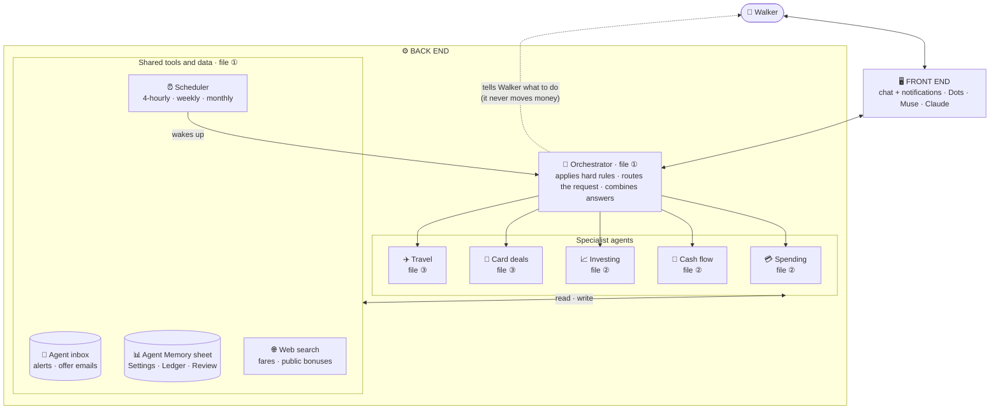

# 🧭 Walker's personal agent

**A personal AI agent that watches your money and your travel deals, tells you what matters, and leaves every decision to you.**

[The problem](#1-the-problem) · [The solution](#2-the-solution) · [How it works](#3-how-an-agent-works) · [The three setup files](#4-the-three-setup-files)

**🚀 Want your AI to set it up with you?** Copy the one prompt in [**START-HERE.md**](START-HERE.md) into ChatGPT, Claude, or Muse.

---

## 1. The problem

Walker's money questions are simple, but answering them means checking four places, and the answers come too late to act on.

| Walker wants to… | Today | Cost |
|---|---|---|
| Know what he spent today | Check the Chase app, then the Amex app, then add it up | He doesn't, so overspending shows up a month later |
| See where last month's money went | Statements from each account, reconciled by hand | No real picture of cash in and out |
| Get the most from Chase and Amex | Scroll the offer pages, remember bonus deadlines | Offers expire unused, and bonuses get missed |
| Invest monthly in his ETFs | Work out the split each month | Easy to delay or drift from the targets |
| Find good international flights | Check fare sites and points programs one by one | Cash vs. points is hard to compare |

## 2. The solution

One agent, defined by three plain-text setup files that work with any major agent platform. It:

- ✅ **pings him** when daily spending crosses his limit, an offer is about to expire, or a watched flight gets cheaper
- ✅ **builds a monthly personal cash flow statement** covering money in, money out, net, and spending peaks
- ✅ **calculates the monthly ETF split** across his approved list
- ✅ **compares flights** by cash and by points, with value per point
- ❌ **never** moves money, trades, pays, books, or logs into a bank. He does those himself. Chase, Schwab and other banks enforce this too, since they now block third-party agents from logging in or sending money ([source](https://forkast.news/?p=132419))

## 3. How an agent works

An agent has a **front end** (where you talk to it) and a **back end** (what does the work). Walker's back end is an **orchestrator** that routes each request to **specialist agents**, all sharing one set of tools and data.

**One request, end to end:** *"Can I afford the Sydney flight this month?"*
1. The **orchestrator** sees two questions: a fare, and this month's money.
2. **Travel** searches fares and points options. **Cash flow** checks this month's spending so far against the Memory sheet.
3. The orchestrator combines both answers into one reply: *"Yes. Cash fare is $620, and you have $800 left in your $1,500 travel budget this month. A points option (45k + $85) exists but is worth only 1.2¢ per point, so pay cash. Book it yourself when ready."*

| Part | What it does | Set up in |
|---|---|---|
| **Front end** | Where Walker asks and gets pings: ChatGPT Dots, Meta Muse, or Claude | [①](setup/1-agent-foundation.md) |
| **Orchestrator** | Holds the hard rules, decides which specialists a request needs, merges their answers, stays silent when nothing matters | [①](setup/1-agent-foundation.md) |
| **Specialist agents** | Each one owns a single job, with its own instructions and tests: Spending, Cash flow, Investing, Card deals, Travel | [②](setup/2-money-in-and-out.md) [③](setup/3-points-and-travel.md) |
| **Shared tools and data** | The agent inbox, the Memory sheet, web search, and the scheduler. Every specialist uses the same ones | [①](setup/1-agent-foundation.md) |
| **Hands** | Deliberately none for money. The agent tells Walker exactly what to do | [①](setup/1-agent-foundation.md) |

> [!NOTE]
> **"Specialist agents" is a design idea, not five subscriptions.** On Dots or Muse, the orchestrator and specialists all run inside **one** agent as separate instruction blocks. On a platform that supports several agents, each specialist could become its own. Either way, adding a new area later (say, health) means adding one specialist, and the orchestrator and shared tools stay as they are.

**Why a separate inbox?** The agent only sees what you route to it. Your main email, bank logins, and brokerage account stay out of reach. That keeps the privacy risk small and avoids flooding your main inbox.

## 4. The three setup files

The whole agent is these three files. Each one explains *why* before *how*, so reading them is the fastest way to see how the back end actually works.

| | File | Teaches | The agent can then… |
|---|---|---|---|
| ① | [**Agent foundation**](setup/1-agent-foundation.md) | The orchestrator, shared tools and data, hard rules | Route requests, read its own inbox and sheet, and refuse anything outside its rules |
| ② | [**Money in and out**](setup/2-money-in-and-out.md) | Three specialists (Spending, Cash flow, Investing): turning alerts and statements into answers | Report daily spending, build the monthly cash flow statement, calculate the ETF split |
| ③ | [**Points and travel**](setup/3-points-and-travel.md) | Two specialists (Card deals, Travel): combining your data with public web data | Flag offers and bonus deadlines, and compare flights by cash vs. points |

**Not in v1:** health tracking (on hold for privacy), direct bank links (optional, read-only), and automated payments (only if banks allow agent payments safely).

---

All amounts and names in the setup files are examples. Keep your real settings in your private Agent Memory sheet, not in this repo. Platform details are as of November 2026.
