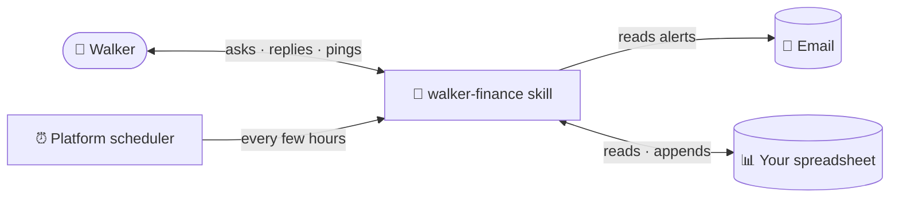

<div align="center">

# 💳 Walker's personal finance assistant

**Know what you spent across every card, get pinged only when it matters, and keep the ledger in your own spreadsheet.**


[**Set up in 5 minutes**](#-set-up-in-5-minutes) · [**Read the PRD**](docs/PRD.md) · [**See the architecture**](docs/architecture.md) · [**Try the demo**](https://zerowing113.github.io/walker-personal-agent/)

</div>

---

## 🧭 What it does

| You ask or it notices… | It answers… |
|---|---|
| *"What did I spend yesterday?"* | **$600 across Chase and Amex**, each purchase counted once, with any card it couldn't read named |
| You cross your daily limit | One short ping: amount, threshold, biggest purchase |
| A card stops sending alerts | *"No Amex alerts for 3 days. Check that alerts are still on."* |
| Something looks like a duplicate | It goes to your **Review** tab, and nothing is guessed or deleted |
| *"Pay this" / "Book that"* | It won't. **You** pay, book, and move money. It reads and prepares. |

## ⚡ Set up in 5 minutes

> Using Claude (Pro or above). For other assistants, see [adapters](adapters/).

1. **Install the skill.** Upload [`dist/walker-finance.zip`](dist/walker-finance.zip) in Claude under **Customize → Skills → +**.
2. **Connect your data.** Turn on the Gmail and Google Drive connectors.
3. **Make your ledger.** Create a Google Sheet named **`Walker Finance Ledger`** with tabs **Ledger · Review · Config**, using the [templates](walker-finance/assets/).
4. **Fill in your settings.** Answer [SETUP.md](SETUP.md) in the **Config** tab. *Don't put your answers in this repo, because it's public.*
5. **Ask it something:**
   ```text
   What did I spend yesterday?
   ```

Full steps, pings, and Duet setup are in the [Claude adapter](adapters/claude.md).

## 🏗️ Architecture

**One agent with specialist playbooks**, written once in the open [SKILL.md format](https://agentskills.io), plugged into any assistant that can read email and edit a spreadsheet.



| Layer | What it is | Where |
|---|---|---|
| **Core** | Logic that never changes per platform: routing, ledger rules, spending, ping rules | [`walker-finance/`](walker-finance/) |
| **Contract** | What any platform must provide: email reader, spreadsheet, scheduler, optional bank link | [architecture §2](docs/architecture.md#2-core-contract-adapters) |
| **Adapters** | How each platform provides it | [`adapters/`](adapters/) |

→ Diagrams, failure handling, the trust boundary, and decision records are in [**docs/architecture.md**](docs/architecture.md).

## 🗺️ Scope

| | Module | Status |
|---|---|---|
| 💳 | **Spending monitor**: daily totals, threshold and large-purchase pings, coverage | ✅ v1 |
| 📒 | **Ledger**: dedupe, alert-to-posting matching, Review tab | ✅ v1 |
| 💵 | **Cash Flow**: monthly in and out, reconciliation | ↪️ Use your platform's bank-link feature; the skill is the fallback |
| ✈️ | **Rewards & Travel**: offers, cash versus points | 🧪 Preview, v1.1 |
| ✅ | **Finance Planning**: monthly checklist, reminders | 🧪 Preview, v1.1 |

Why this split? See [PRD §4 Build vs. buy](docs/PRD.md#4-build-vs-buy).

## 📁 What's in this repo

```text
walker-personal-agent/
├── README.md               ← you are here
├── SETUP.md                ← questionnaire (answer privately)
├── docs/
│   ├── PRD.md              ← what and why: goals, scope, metrics
│   └── architecture.md     ← how: diagrams, contract, decisions
├── walker-finance/         ← the portable skill (the actual agent)
│   ├── SKILL.md
│   ├── references/         ← one playbook per module + ledger, config, pings
│   └── assets/             ← blank ledger and config templates
├── adapters/               ← Claude · ChatGPT · Gemini · paste-ready
├── dist/walker-finance.zip ← ready to upload
├── demo/                   ← scripted chat demos (fictional data)
└── index.html              ← interactive prototype
```

<sub>All names, amounts, and quotes in this repo are fictional. Platform features referenced are as of November 2026.</sub>
