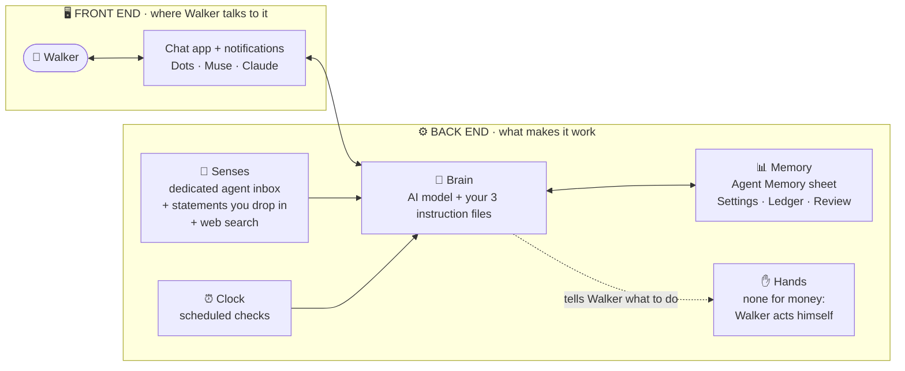

# 🧭 Walker's personal agent

**A personal AI agent that watches your money and your travel deals, tells you what matters, and leaves every decision to you.**

[The problem](#1-the-problem) · [The solution](#2-the-solution) · [How it works](#3-how-an-agent-works) · [Build it](#4-build-it) · [Plan](#5-build-plan)

---

## 1. The problem

Walker's money questions are simple, but answering them means checking four places, and the answers come too late to act on.

| Walker wants to… | Today | Cost |
|---|---|---|
| Know what he spent today | Check the Chase app, then the Amex app, then add it up | He doesn't, so overspending shows up a month later |
| See where last month's money went | Statements from each account, reconciled by hand | No real picture of cash in and out |
| Get the most from Chase and Amex | Scroll the offer pages, remember bonus deadlines | Offers expire unused, and bonuses get missed |
| Invest monthly in his ETFs | Work out the split each month | Easy to delay or drift from the targets |
| Find good international flights | Check fare sites and points programs one by one | Cash vs. points is hard to compare |

## 2. The solution

One agent, set up by Walker himself from three instruction files, that:

- ✅ **pings him** when daily spending crosses his limit, an offer is about to expire, or a watched flight gets cheaper
- ✅ **builds a monthly personal cash flow statement** covering money in, money out, net, and spending peaks
- ✅ **calculates the monthly ETF split** across his approved list
- ✅ **compares flights** by cash and by points, with value per point
- ❌ **never** moves money, trades, pays, books, or logs into a bank. He does those himself. Chase, Schwab and other banks enforce this too, since they now block third-party agents from logging in or sending money ([source](https://forkast.news/?p=132419))

## 3. How an agent works

An agent has a **front end** (where you talk to it) and a **back end** (what it knows, reads, remembers, and when it wakes up).

| Part | In Walker's agent | Set up in |
|---|---|---|
| **Front end** | ChatGPT Dots, Meta Muse, or Claude. Any of them works | [①](setup/1-agent-foundation.md) |
| **Brain** | The platform's AI model, plus the rules and workflows you paste in | ①②③ |
| **Senses** | A separate Gmail that receives Chase and Amex alerts and offer emails, plus monthly statements | [①](setup/1-agent-foundation.md) |
| **Memory** | One Google Sheet you own: your settings, a running ledger, and a review list | [①](setup/1-agent-foundation.md) |
| **Clock** | Scheduled checks (every 4 hours, weekly, monthly) | [②](setup/2-money-in-and-out.md) [③](setup/3-points-and-travel.md) |
| **Hands** | Deliberately none for money. The agent tells Walker exactly what to do | [①](setup/1-agent-foundation.md) |

**Why a separate inbox?** The agent only sees what you route to it. Your main email, bank logins, and brokerage account stay out of reach. That keeps the privacy risk small and avoids flooding your main inbox.

## 4. Build it

Do these in order, about 20 minutes each. Each file explains *why*, walks you through setup, gives you instructions to paste, and ends with tests.

| | File | You'll end with |
|---|---|---|
| ① | [**Agent foundation**](setup/1-agent-foundation.md) | The agent account, the memory sheet, the alerts routed, and the hard rules in place |
| ② | [**Money in and out**](setup/2-money-in-and-out.md) | Daily spending alerts, the monthly cash flow statement, and the ETF transfer reminder |
| ③ | [**Points and travel**](setup/3-points-and-travel.md) | Card offer and bonus alerts, plus flight comparisons by cash vs. points |

## 5. Build plan

| When | What | Outcome |
|---|---|---|
| **Meeting 1** (30 min) | Build ① together: account, sheet, alerts, rules | The agent answers "what did I spend today?" |
| **Before meeting 2** | Walker runs it for a week and notes what's annoying | A list of real pain points |
| **Meeting 2** (30 min) | Build ② and ③, then tune thresholds from week one | Statement, ETF reminder, offers, flights all live |
| **About 1 month later** (virtual, from Australia) | Review pings, the first monthly statement, and real flight searches | Decide what to fix, and whether to add health or other areas |

**Later, not now:** health tracking (on hold for privacy), direct bank links (optional, read-only), and automated payments (only if banks allow agent payments safely).

---

All amounts and names in the setup files are examples. Keep your real settings in your private Agent Memory sheet, not in this repo. Platform details are as of November 2026.
