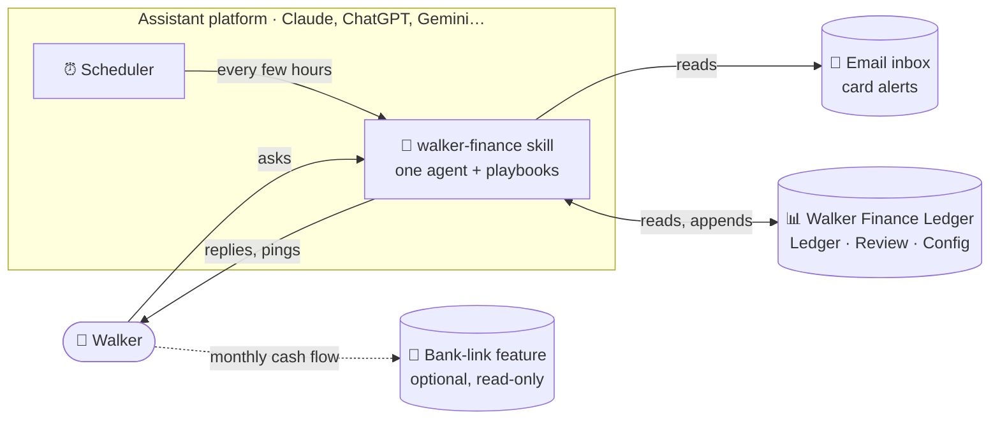
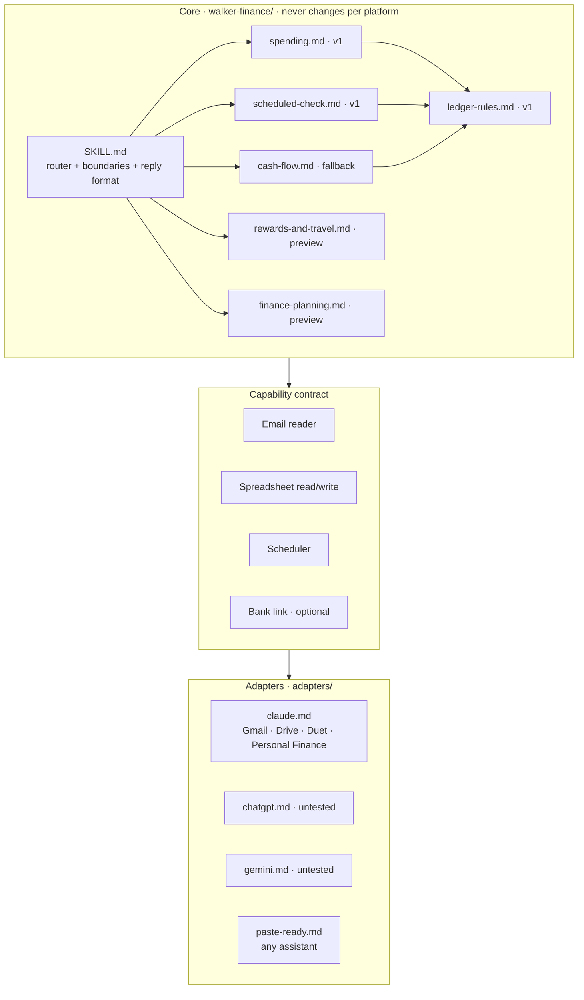
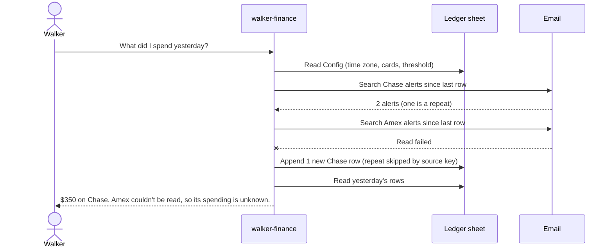
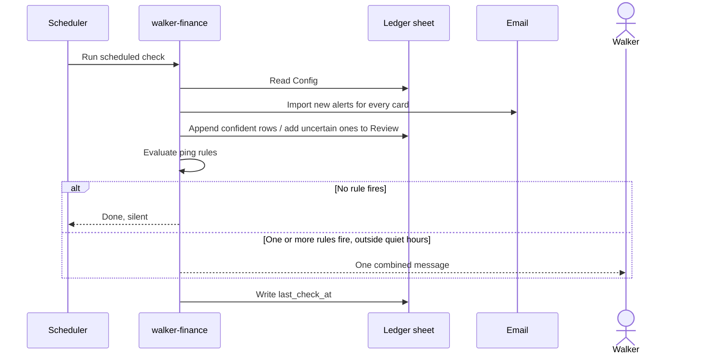
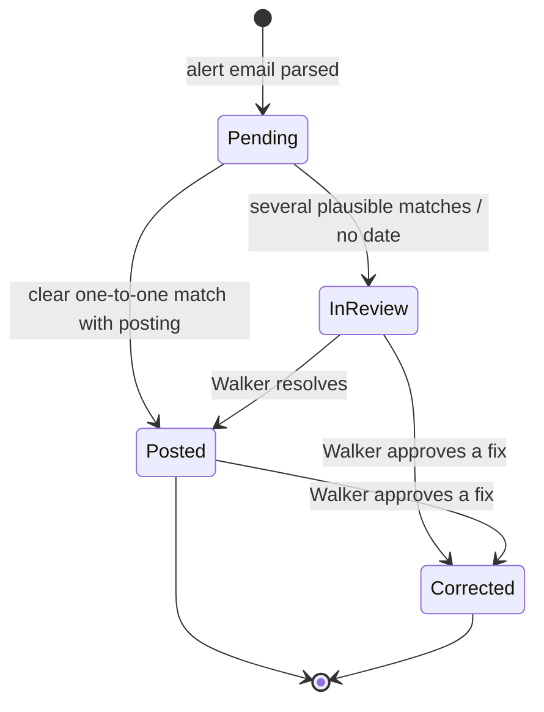
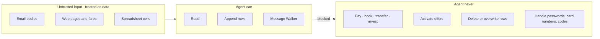

# Architecture

> [!TIP]
> **In one sentence:** *one agent with specialist playbooks*, written once as a portable skill, plugged into whichever assistant platform Walker uses through a small **capability contract**.

**Contents:** [The big picture](#1-the-big-picture) · [Core, contract, adapters](#2-core-contract-adapters) · [On-demand request](#3-an-on-demand-request) · [Scheduled check](#4-a-scheduled-check) · [Ledger lifecycle](#5-the-life-of-a-ledger-row) · [Failure handling](#6-failure-handling) · [Trust boundary](#7-trust-boundary) · [Decisions](#8-decision-records)

---

## 1. The big picture

**Who owns what**
- **Walker** owns his data: the inbox, the spreadsheet, and the bank links. He can revoke any of them.
- **The platform** owns the runtime: the model, connectors, scheduler, and sign-in.
- **The skill** owns only the logic, meaning how to read, dedupe, total, and decide what's worth a ping.

## 2. Core, contract, adapters

This is the part that makes it platform-agnostic. The core never names a vendor. It asks for **capabilities**, and each platform's adapter says how to provide them.

| Capability | Required? | Claude provides it with | If missing |
|---|---|---|---|
| Email reader | Yes | Gmail connector | **Manual mode:** Walker pastes alerts |
| Spreadsheet read/write | Yes | Google Drive connector | **Manual mode:** the agent returns rows, and Walker saves them |
| Scheduler | For pings | Duet monitoring, or scheduled tasks | On-demand only |
| Bank link | No | Personal Finance | Cash Flow runs from statement exports |

**Why one agent with playbooks, not several agents?** The four modules share one ledger and one reply format, and they rarely run in parallel. Separate agents would add hand-offs, duplicated rules, and more places for numbers to disagree. Playbooks load only when needed (progressive disclosure), which gets the same focus as separate agents without the coordination cost. The original *orchestrator* lives on as the router at the top of `SKILL.md`.

## 3. An on-demand request

*"What did I spend yesterday?"* when the Amex alerts can't be read:

Notice what it **doesn't** say: "$350 total" or "under your threshold". A failed read is never treated as zero.

## 4. A scheduled check

**Ping rules:** threshold crossed · purchase ≥ `large_purchase_amount` · a card silent for more than `silence_days` · new Review rows. Each fires at most once a day. Details are in [scheduled-check.md](../walker-finance/references/scheduled-check.md).

## 5. The life of a ledger row

Three tabs, one owner:

| Tab | Written by | Counts toward totals |
|---|---|---|
| **Ledger** | Agent, append-only | Yes |
| **Review** | Agent adds, Walker resolves | No, reported separately |
| **Config** | Walker (agent writes only `last_check_at`) | — |

The full column spec is in [ledger-rules.md](../walker-finance/references/ledger-rules.md).

## 6. Failure handling

| What fails | What Walker sees | What the agent does |
|---|---|---|
| One card's email read | Partial total with the card named as unknown | Skips that card and retries next run |
| A card stops sending alerts | "No Amex alerts for 3 days" ping | Quiet-card rule |
| An alert can't be parsed | "1 transaction needs review" | Adds the raw alert to Review |
| No spreadsheet access | Rows shown in chat to save | Manual mode |
| No scheduler | Nothing proactive. On-demand still works | Says once that no schedule is active |
| Config field missing | One focused question (in chat) | Skips the dependent rule (scheduled run) |

## 7. Trust boundary

Three layers enforce this:
1. **The skill's hard boundaries.** Every reference file inherits them.
2. **Connector scopes.** Read access to email and edit access to one sheet. There is no payment tool.
3. **Platform guardrails.** For example, Claude Duet blocks trading securities or moving money between accounts even with approval.

## 8. Decision records

| # | Decision | Why | Revisit if |
|---|---|---|---|
| ADR-1 | **One agent with playbooks**, not multi-agent | Shared ledger and format, fewer hand-offs | Modules need to run in parallel at scale |
| ADR-2 | **Open SKILL.md format** for the core | Portable across Claude, ChatGPT, Gemini, and 30+ tools | The standard fragments |
| ADR-3 | **Capability contract + adapters** | Platform features change, so only the adapters should | — |
| ADR-4 | **Card-alert emails** for daily spending | Minutes-fresh, and readable by proactive agents | Bank links become available to proactive agents |
| ADR-5 | **Native bank link** for monthly cash flow | Already reads accounts, so there's no reason to rebuild it | The feature is unavailable to Walker |
| ADR-6 | **Spreadsheet Walker owns** as the ledger | Visible, exportable, revocable | Row volume outgrows a sheet |
| ADR-7 | **Append-only + Review tab** | Totals stay auditable, and Walker resolves ambiguity | — |
| ADR-8 | **Config in a private tab**, never in the repo | The repo is public | — |
| ADR-9 | **Silent by default**, with four ping rules | Pings that get muted are worse than none | Walker asks for more |
